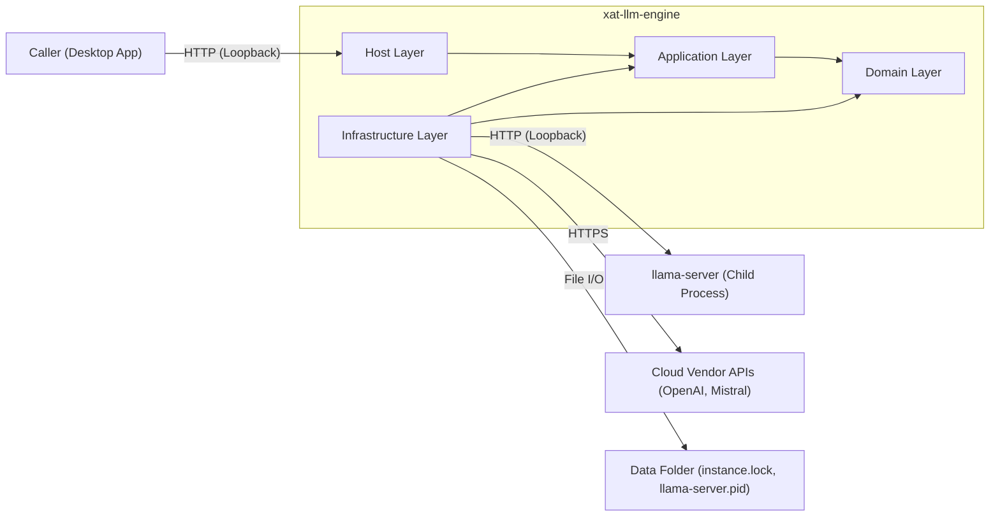
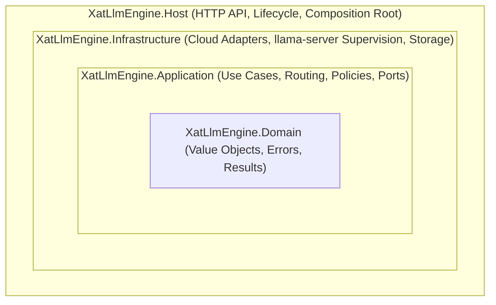
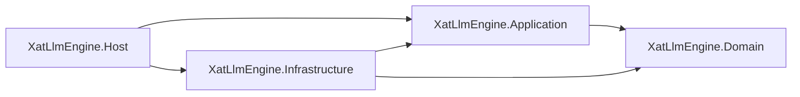
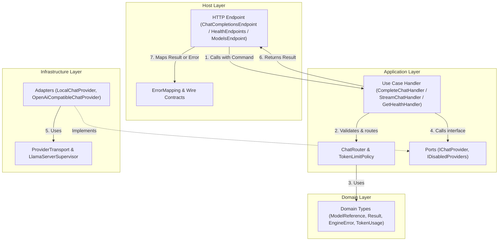
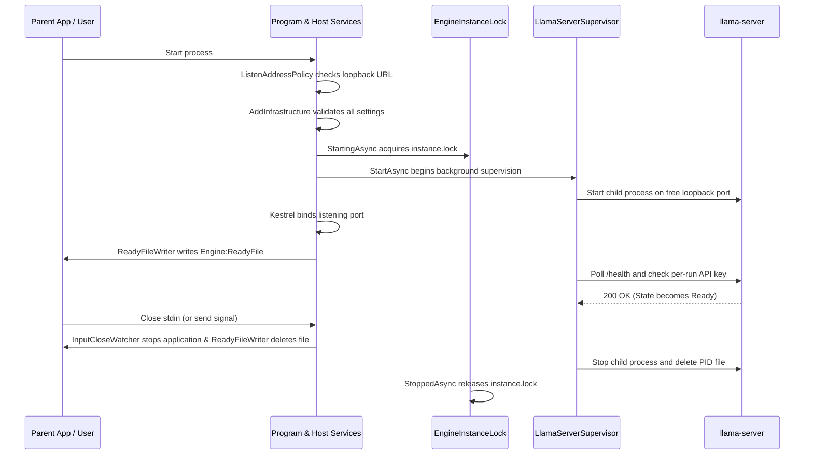
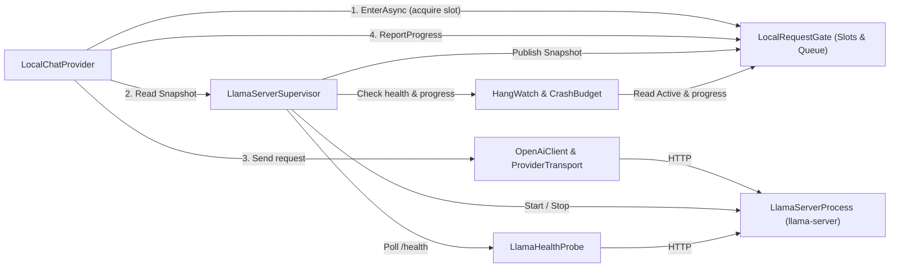
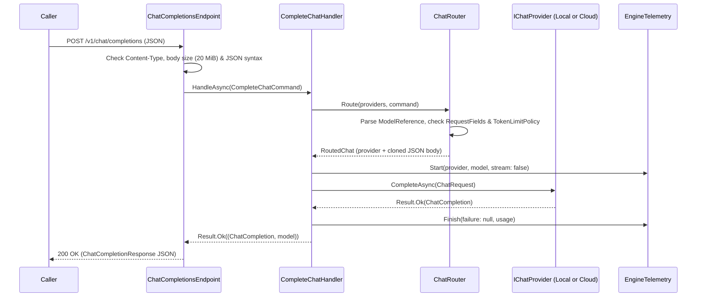
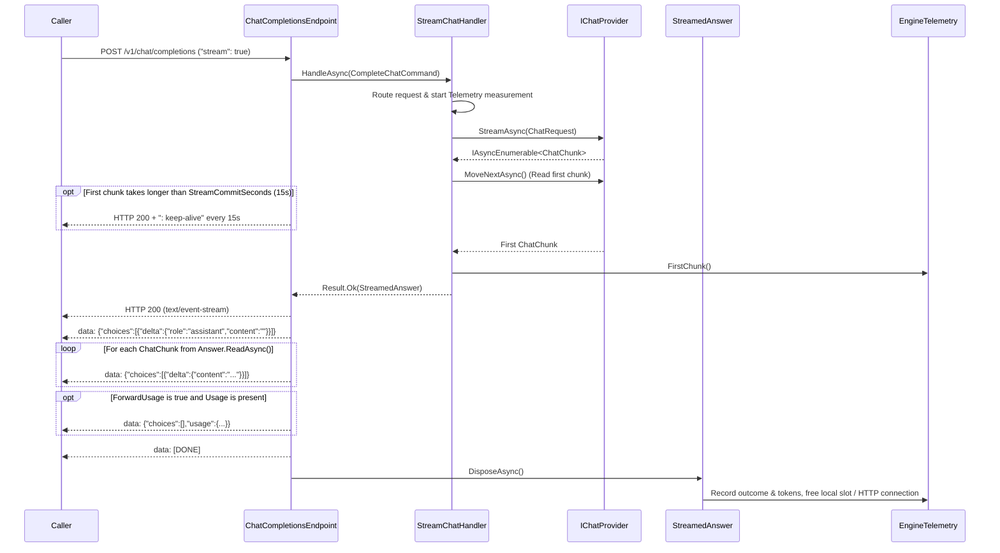
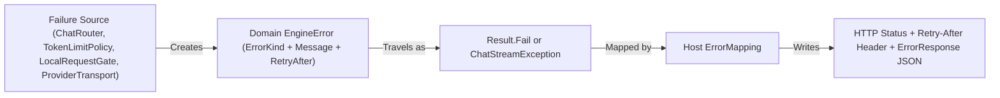

# Architecture

This page describes the architecture of `xat-llm-engine`, its four layers, the interactions between layers and components, and the flow of data.

## System overview

The engine is a local HTTP server that a desktop app runs on the user's machine. It gives callers one local API for a supervised `llama-server` child process and for cloud vendors.

## Architectural layers

The codebase follows Clean Architecture. Source-code dependencies point inward only. `tests/XatLlmEngine.Architecture.Tests` checks these rules on every build.

| Layer | Project | May reference | Purpose |
|---|---|---|---|
| Domain | `src/XatLlmEngine.Domain` | Nothing | Core types, value objects, error categories and results. |
| Application | `src/XatLlmEngine.Application` | `Domain` | Use cases, routing, request validation, cost policies, telemetry and ports. |
| Infrastructure | `src/XatLlmEngine.Infrastructure` | `Application`, `Domain` | Provider adapters, HTTP transport, `llama-server` supervision and file storage. |
| Host | `src/XatLlmEngine.Host` | `Application`, `Infrastructure` | HTTP endpoints, wire contracts, error mapping, lifecycle services and dependency injection. |

### Domain layer (`XatLlmEngine.Domain`)

The Domain layer has no framework references and performs no I/O. It holds the types that every other layer shares:

- `ModelReference`: parses and validates a `provider/model` string.
- `Result<T>`: represents the outcome of an operation that can fail in an expected way.
- `EngineError` and `ErrorKind`: describe expected failures in business terms (`InvalidRequest`, `NotFound`, `RateLimited`, `Unavailable`, `Upstream` and `Overloaded`), with an optional `RetryAfter` wait.
- `TokenUsage`: holds input, output and total token counts.
- `FinishReason`: gives the reason why generation ended (`Stop`, `Length` or `ContentFilter`).

### Application layer (`XatLlmEngine.Application`)

The Application layer orchestrates the use cases and enforces provider-independent rules:

- **Ports (`Abstractions/`)**:
  - `IChatProvider`: the port for any source of chat answers. It exposes the provider's name, models, request template (`RequestFields`), output token limit (`MaxTokensLimit`), health status, `CompleteAsync` and `StreamAsync`.
  - `IDisabledProviders`: lists configured providers that are turned off.
- **Use cases (`Features/`)**:
  - `CompleteChatHandler`: validates a chat command, calls the provider for a complete answer, and records metrics and traces.
  - `StreamChatHandler`: validates a chat command, starts the provider stream, and reads the first chunk before it returns.
  - `ListModelsHandler`: returns the advertised models from all enabled providers in configuration order.
  - `GetHealthHandler`: combines the status of each enabled and disabled provider into `EngineHealth`.
- **Routing and policies (`Features/CompleteChat/`)**:
  - `ProviderRegistry`: indexes enabled `IChatProvider` instances by name.
  - `ChatRouter`: selects the provider from `ModelReference`, checks every top-level field against the provider's `RequestFields`, and applies the output token ceiling with `TokenLimitPolicy`.
- **Diagnostics (`Diagnostics/`)**:
  - `EngineTelemetry`: records built-in .NET metrics and activities (`XatLlmEngine`), including `xat_engine.chat.requests`, `xat_engine.chat.duration`, `xat_engine.chat.time_to_first_chunk` and `xat_engine.tokens` (tagged by `provider`, `model` and `direction`).

### Infrastructure layer (`XatLlmEngine.Infrastructure`)

The Infrastructure layer implements the Application ports. All adapter classes are `internal sealed`, so outer code can reach them only through their ports and `AddInfrastructure()`:

- **Cloud adapters (`Providers/`)**:
  - `OpenAiCompatibleChatProvider`: implements `IChatProvider` for OpenAI-format services (`openai`, `mistral` and custom providers).
  - `OpenAiClient`: speaks the OpenAI chat completions protocol. Both `OpenAiCompatibleChatProvider` and `LocalChatProvider` share this client.
  - `ProviderTransport` and `HttpFailure`: send HTTP requests without retries, enforce header and idle-read time limits, cap response sizes, read SSE streams, and translate HTTP and network failures into `EngineError`.
- **Local model supervision (`LlamaCpp/`)**:
  - `LocalChatProvider`: implements `IChatProvider` for the `local` provider. It checks the model name, acquires a slot from `LocalRequestGate`, sets the default temperature, and calls `OpenAiClient`.
  - `LlamaServerSupervisor`: a background service that starts `llama-server` on a free loopback port with a per-run API key, polls its health, and restarts it after crashes or hangs.
  - `LocalRequestGate`: limits active requests to `LocalModel:Parallel` and queues waiting requests up to `LocalModel:MaxQueuedRequests`.
  - `HangWatch` and `CrashBudget`: decide when an unresponsive `llama-server` must be replaced and stop restarts after 3 crashes in 10 minutes.
  - `LlamaServerProcess` and `ChildProcessJob`: start `llama-server` with a clean environment and bind it to a Windows job object when running on Windows.
- **Engine state and storage**:
  - `EngineDataFolder`: resolves the data folder for the installation.
  - `EngineInstanceLock`: holds an exclusive lock on `instance.lock` so only one engine runs per data folder.

### Host layer (`XatLlmEngine.Host`)

The Host layer is the entry point and the composition root:

- `Program.cs`: checks the listening address with `ListenAddressPolicy`, registers options, services and middleware, maps the HTTP routes, and starts the web server.
- **Endpoints (`Endpoints/`)**:
  - `ChatCompletionsEndpoint`: handles `POST /v1/chat/completions` for complete and streamed answers.
  - `ModelsEndpoint`: handles `GET /v1/models`.
  - `HealthEndpoints`: handles `GET /health`, `GET /health/live` and `GET /health/ready`.
- **Contracts and error mapping (`Contracts/`)**:
  - `ErrorMapping`: maps every `EngineError` and HTTP status to the unified `{"error":{"message","type"}}` body and sets the `Retry-After` header.
  - `HostJson`: source-generated JSON serialization context for wire contracts.
- **Lifecycle and diagnostics (`Lifecycle/`, `Diagnostics/`)**:
  - `ReadyFileWriter`: writes the address, process ID and version to `Engine:ReadyFile` when the API starts, and deletes the file on stop.
  - `InputCloseWatcher`: stops the engine when standard input closes if `Engine:StopWhenInputCloses` is `true`.
  - `RequestIdMiddleware` and `ChatRequestLog`: attach `X-Request-Id` to every response and log one summary line per chat request without prompts or answers.

## Interactions between architectural layers

The layers interact through explicit method calls and ports:

1. **Composition at startup**: `Host` calls `AddApplication()` and `AddInfrastructure(configuration)` in `Program.cs`. `Infrastructure` validates all settings at startup, registers `IChatProvider` and `IDisabledProviders`, and starts its background services. `Host` never references adapter classes in `XatLlmEngine.Infrastructure.LlamaCpp` or `XatLlmEngine.Infrastructure.Providers`.
2. **Inbound calls (`Host` to `Application`)**: HTTP endpoints in `Host` read and validate the HTTP framing (content type, body size and JSON syntax), build an Application command, and call a handler (`CompleteChatHandler`, `StreamChatHandler`, `ListModelsHandler` or `GetHealthHandler`).
3. **Domain rules (`Application` to `Domain`)**: Application handlers and policies use `Domain` types (`ModelReference`, `Result<T>`, `EngineError`, `TokenUsage` and `FinishReason`) to represent routing, validation and results without transport details.
4. **Outbound calls (`Application` to `Infrastructure` via ports)**: Application handlers call `IChatProvider`. The `Infrastructure` adapters translate between vendor wire protocols (or `llama-server`) and the Application/Domain types. Expected external failures never cross the port as raw HTTP exceptions. Adapters return `Result<T>.Fail(EngineError)` before a stream starts, or throw `ChatStreamException(EngineError)` when a stream breaks after it starts.

## Interactions between components

### Startup and lifecycle components

1. `ListenAddressPolicy` verifies that the listening address is on loopback before the host builds.
2. `DependencyInjection.AddInfrastructure` validates `Engine`, `LocalModel` and `Providers` settings. Any invalid setting stops the process at once.
3. `EngineInstanceLock` acquires an exclusive file lock on `instance.lock` in `EngineDataFolder` before other hosted services start.
4. When Kestrel starts listening, `ReadyFileWriter` atomically writes `{"url","pid","version"}` to `Engine:ReadyFile`.
5. If `Engine:StopWhenInputCloses` is `true`, `InputCloseWatcher` waits for standard input to close and then triggers a clean stop.

### Local model supervision and load components

`LocalChatProvider`, `LocalRequestGate` and `LlamaServerSupervisor` work together to manage the local model:

- **Slot and queue gate**: `LocalRequestGate` lets at most `LocalModel:Parallel` requests run at the same time. Additional requests wait in a queue up to `LocalModel:MaxQueuedRequests`. If the queue is full, `EnterAsync` returns `ErrorKind.Overloaded` (HTTP 503) at once.
- **Health and hang detection**: `LlamaServerSupervisor` polls `llama-server` with `LlamaHealthProbe` every `HealthCheckIntervalSeconds`. Every completed answer and every streamed chunk calls `gate.ReportProgress()`.
  - If `llama-server` fails 3 health checks in a row while no request runs, `HangWatch` tells the supervisor to restart it.
  - If `llama-server` fails 3 health checks while a request runs, the state becomes `Unresponsive`. New requests get HTTP 503, while active requests continue as long as `llama-server` sends data.
  - If an `Unresponsive` server sends no data for `UnresponsiveTimeoutSeconds`, `HangWatch` tells the supervisor to restart it.
- **Crash budget**: If `llama-server` fails during initial load, the supervisor sets the state to `Failed` and does not retry. If `llama-server` crashes after it became `Ready`, `CrashBudget` allows restarts until 3 crashes occur within 10 minutes, after which the state becomes `Failed` (HTTP 502).

### Cloud provider and cost-control components

- **Protocol adapter and transport**: `OpenAiCompatibleChatProvider` uses `OpenAiClient` and sends requests through `ProviderTransport`. `ProviderTransport` disables HTTP redirects, enforces `RequestTimeoutSeconds` on response headers, wraps the response stream in an `IdleTimeoutStream` (`ReadIdleTimeoutSeconds`) and a `SizeLimitedStream` (16 MiB), and maps HTTP errors with `HttpFailure`.
- **Per-request token limit**: `TokenLimitPolicy` enforces `MaxTokensLimit` before a request reaches the provider. It validates the provider's token field (`max_tokens` or `max_completion_tokens`) or inserts `MaxTokensLimit` when the caller sent no token field.

## Flow of data

### 1. Complete chat request (`stream: false`)

1. **HTTP intake**: `RequestIdMiddleware` assigns `X-Request-Id`. `ChatCompletionsEndpoint` checks that `Content-Type` is `application/json`, reads the body up to `Api:MaxRequestBodyBytes` (20 MiB), parses the `JsonObject`, and verifies that there are no duplicate keys or invalid UTF-16 strings.
2. **Routing and token limit**: `ChatRouter.Route` parses `model` into `provider/model` and looks up the provider in `ProviderRegistry`. It checks every top-level field against `model`, `stream` and the provider's `RequestFields`. `ChatRouter` clones the JSON body and runs `TokenLimitPolicy.Apply` to validate or insert `MaxTokensLimit`.
3. **Provider execution**: `CompleteChatHandler` starts an `EngineTelemetry` measurement and calls `IChatProvider.CompleteAsync`. The provider sends the request body over `ProviderTransport` to `llama-server` or the cloud vendor API, then maps the response into a Domain `ChatCompletion` (`Content`, `FinishReason`, `TokenUsage`).
4. **Telemetry and response**: `CompleteChatHandler` finishes the `EngineTelemetry` measurement and records the reported input and output tokens. `ChatCompletionsEndpoint` writes the `ChatCompletionResponse` JSON and logs one summary line.

### 2. Streamed chat request (`stream: true`)

1. **First-piece commit**: `StreamChatHandler` routes the request, starts an `EngineTelemetry` measurement, calls `provider.StreamAsync`, and calls `MoveNextAsync()` to read the first `ChatChunk` before it returns. If an error occurs before the first chunk and before `StreamCommitSeconds` elapses, `ChatCompletionsEndpoint` returns a normal HTTP error status code (such as 400, 429, 502 or 503).
2. **Keep-alive timer**: While `ChatCompletionsEndpoint` waits for `StreamChatHandler`, `KeepAliveUntilAsync` watches `Api:StreamCommitSeconds` (15 seconds by default). If the first chunk has not arrived by then, the endpoint commits HTTP 200 (`text/event-stream`) and sends `: keep-alive` comments every 15 seconds.
3. **Chunk forwarding**: Once the first chunk arrives, `ChatCompletionsEndpoint` sends an initial assistant role chunk, then iterates `StreamedAnswer.ReadAsync()` to send each content delta and finish reason as an SSE `data:` event.
4. **Usage and completion**: For providers whose template includes `stream_options`, `OpenAiClient` always requests `stream_options.include_usage = true` so the engine can record token metrics and logs. `StreamedAnswer` forwards the final usage chunk to the caller only when the caller set `stream_options.include_usage` to `true`. The endpoint then sends `data: [DONE]`.
5. **Mid-stream failure and cleanup**: If a failure happens after HTTP 200 was sent, `ChatCompletionsEndpoint` catches `ChatStreamException`, writes `data: {"error":{"message","type"}}`, and omits `[DONE]`. Disposing `StreamedAnswer` finishes the `EngineTelemetry` measurement, returns the HTTP connection to the pool, and releases the `LocalRequestGate` slot.

### 3. Error flow

- Every expected failure in `Application` or `Infrastructure` becomes an `EngineError` with one `ErrorKind`.
- `ErrorMapping` in `Host` maps `ErrorKind` to one HTTP status code and one error type string (`invalid_request_error`, `not_found_error`, `rate_limit_error`, `upstream_error`, `service_unavailable_error` or `overloaded_error`).
- For temporary failures (`RateLimited`, `Unavailable` and `Overloaded`), `ErrorMapping` sets the `Retry-After` response header.
- Unexpected exceptions are caught by the global exception handler in `Program.cs`, logged with the request's `X-Request-Id`, and returned as HTTP 500 `internal_error` without internal details.

